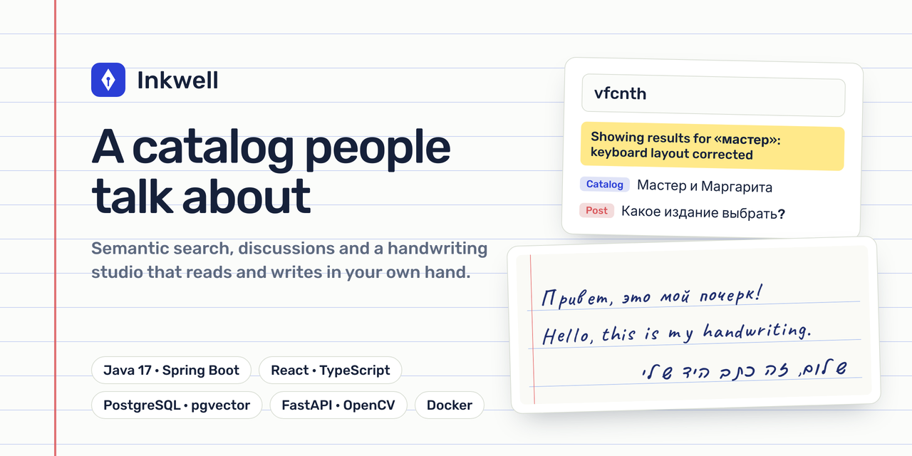
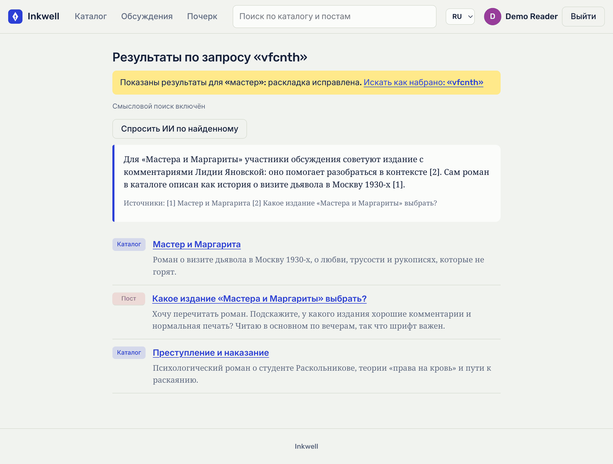
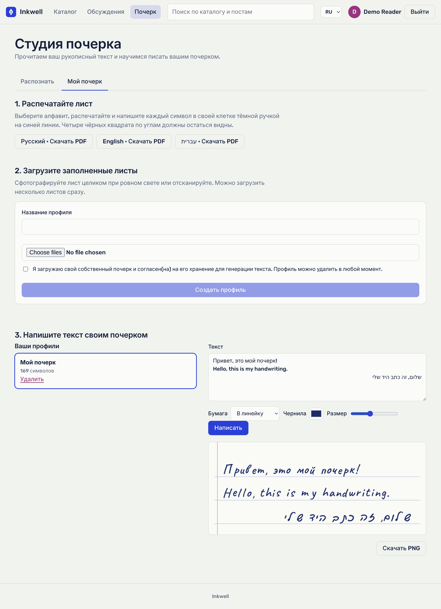
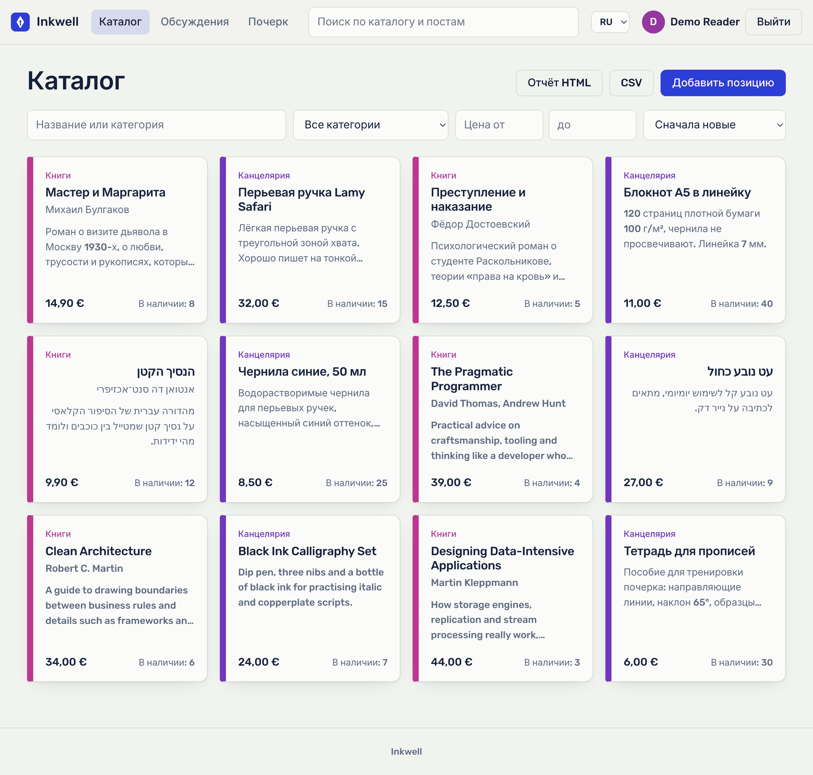
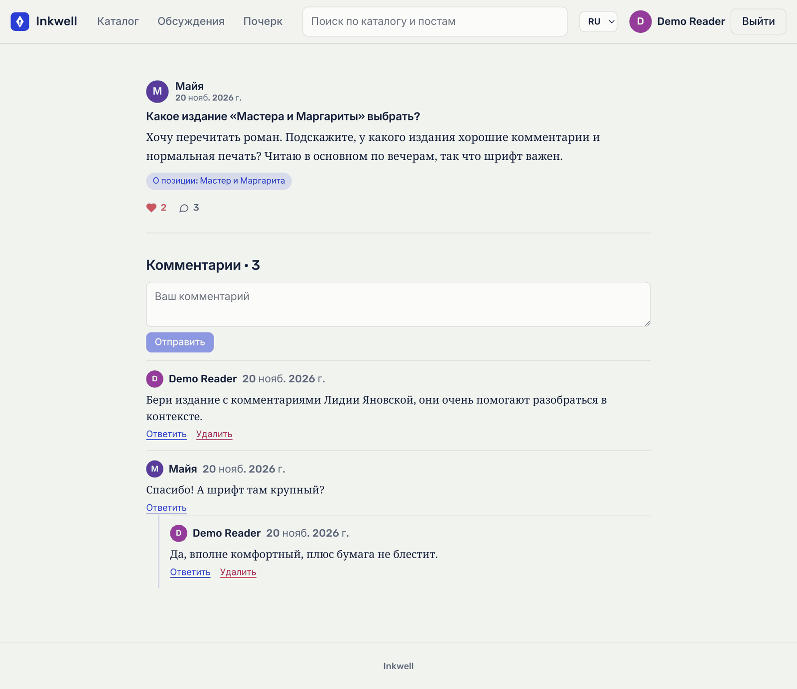
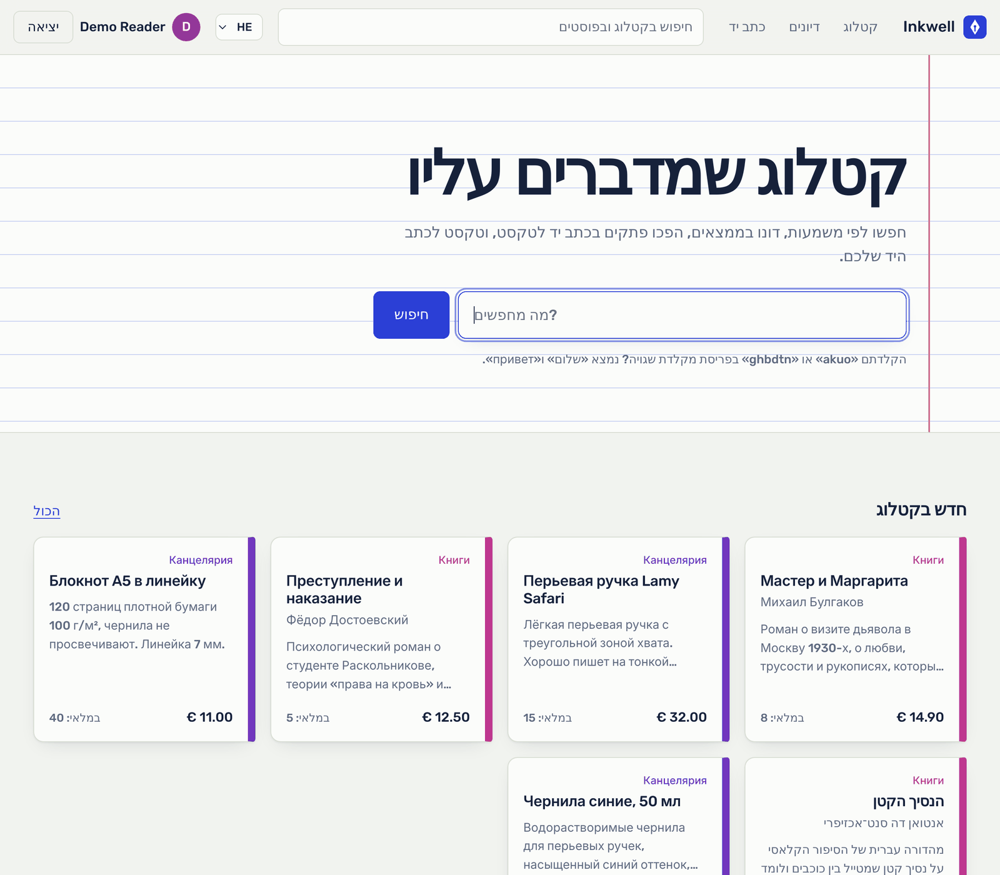
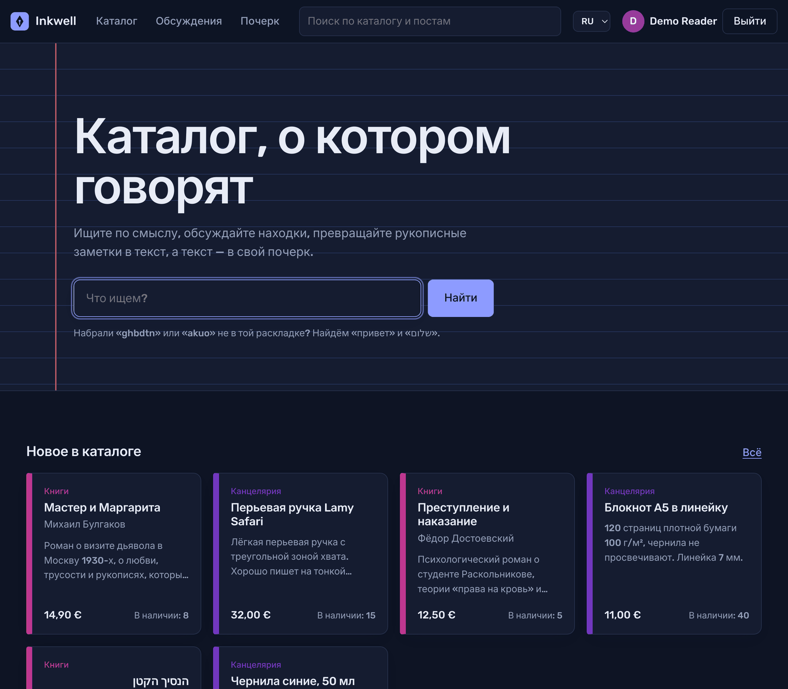
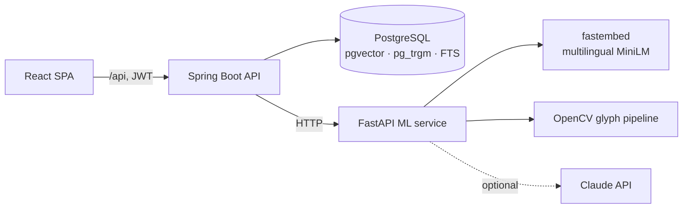
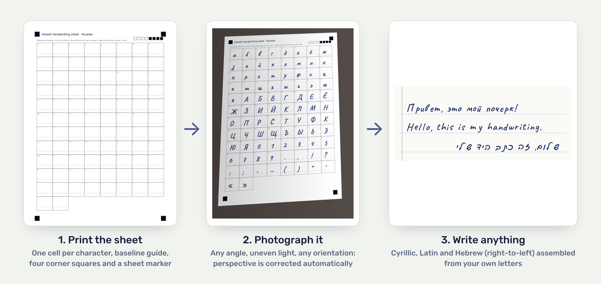

# Inkwell



A catalog with a conversation attached, plus a handwriting studio.

Browse a catalog, find things by *meaning* rather than exact words, discuss them in posts and threaded comments,
turn a photo of handwritten notes into text, and turn text back into **your own handwriting**.
The interface speaks Russian, English and Hebrew (full RTL).

| | |
|---|---|
| **Backend** | Java 17, Spring Boot 3.3, Spring Security + JWT, Spring Data JPA, Flyway, OpenAPI |
| **Database** | PostgreSQL 16 with `pgvector` (semantic search), `pg_trgm` and full-text search |
| **Frontend** | React 18, TypeScript, Vite, TanStack Query, React Router |
| **ML sidecar** | Python 3.12, FastAPI, OpenCV, Pillow, fastembed (multilingual embeddings), Claude vision (optional) |
| **Ops** | Docker Compose, GitHub Actions |

## Screenshots

*The real frontend running against demo data.*

**Search that survives a wrong keyboard layout.** `vfcnth` was typed on the English layout; the engine finds that it means `мастер`, says so,
and offers to search the text as typed. "Ask AI" answers only from the hits, with numbered citations.



**Handwriting studio.** Print a sheet, photograph it, and write new text in your own letters. Hebrew paragraphs run right-to-left.



**Catalog** with filters, sorting and a coloured binding per category · **threaded discussion** under a post:




**Three languages, full RTL, light and dark.** The layout mirrors for Hebrew (navigation, bindings, margin line) and each post picks its own text direction.

| Hebrew (RTL) | Dark theme |
|---|---|
|  |  |

## Run it

```bash
make up            # copies .env.example to .env on first run, builds and starts everything
```

Open **http://localhost:3000**. Demo accounts are seeded on an empty database: `demo / demo12345`, `admin / admin12345`.
API docs: http://localhost:8080/swagger-ui.html.

The first build downloads the embedding model into the ML image (~250 MB), so allow a few minutes.
Set `ANTHROPIC_API_KEY` in `.env` to enable Claude-based handwriting recognition and the "Ask AI" panel.
Without it, recognition falls back to Tesseract and everything else keeps working.

### Develop without Docker for the app

```bash
make db                                        # PostgreSQL + pgvector only
cd backend && mvn spring-boot:run              # http://localhost:8080
cd ml-service && pip install -r requirements.txt && uvicorn app.main:app --port 8000
cd frontend && npm install && npm run dev      # http://localhost:5173, proxies /api to :8080
```

## Architecture



The Java service owns all data and every security decision. The Python service is stateless: it never touches the database
and receives everything it needs per request, so it can be scaled, replaced or switched off independently.
If it is down, the catalog, posts and text search keep working.

### Domain

`User` · `CatalogItem` ⇄ `Author` · `Post` (optionally about a catalog item) · `Comment` (threaded) · `PostLike` · `Follow` · `HandwritingProfile`

## Search

`GET /api/search?q=…` runs three retrievers per table and merges them with **Reciprocal Rank Fusion**:

1. PostgreSQL full-text search, prefix-matching, `simple` configuration (language-neutral, so Hebrew, Russian and English share one index)
2. `pg_trgm` similarity on titles (typo tolerance)
3. `pgvector` cosine distance over 384-d multilingual embeddings (a query in Russian finds an English book)

**Keyboard-layout repair.** If a query finds nothing as typed but its repaired form does, the repaired form is used and the UI
says so (with a "search as typed" link that sets `exact=true`): `ghbdtn` → `привет`, `akuo` → `שלום`, and the reverse directions. It is data-driven (it checks the index) rather than
guessing the language, so `dog` stays `dog`. The Hebrew table is ported from the JibToHeb MCP server; Russian ЙЦУКЕН was added.

**Ask AI.** `POST /api/search/ask` retrieves the top hits and asks Claude to answer *only* from them, with numbered citations.

Embeddings are computed after commit, off the request thread, and a scheduled sweep fills in rows saved while the ML service was down.
User input never reaches the `tsquery` syntax: queries are rebuilt from letters and digits only.

## Handwriting

### Recognition
Upload a photo. With an API key, a vision model transcribes it (Hebrew, Russian and English, mixed lines included),
otherwise Tesseract (`heb+rus+eng`) is used. The text can be published as a post, flagged as handwritten.

### Generation in your own hand



*The demo "handwriting" in these images comes from handwriting fonts standing in for a person; the sheet, photo correction, extraction and rendering are the real pipeline.*

No model is trained and nothing is guessed from other people's writing; the output is assembled from *your* letters.

1. **Print a sheet** (`/api/handwriting/template`). Each A4 sheet has a grid with one cell per character, a baseline guide,
   four black registration squares in the corners and an 8-bit marker that encodes which sheet it is.
2. **Photograph or scan it.** The service finds the four squares, corrects perspective, reads the marker (so sheets can be uploaded in any order,
   in any orientation), flattens uneven lighting and cuts out every character together with how far it sits below the baseline.
   Uploading several sheets adds style variants per character (up to four).
3. **Write.** Text is laid out with random variant choice, small rotation, scale and baseline jitter, line drift and optional ruled paper.
   Hebrew paragraphs are laid out right-to-left; numbers and Latin words inside them keep their reading direction.

The glyph pack is a small zip stored in PostgreSQL. Profiles are private, capped at five per user, require explicit consent,
can be deleted at any time, and rendering is restricted to the profile's owner: nobody can generate text in someone else's handwriting.

**Honest limits.** Glyph assembly looks like careful hand-lettering, not flowing cursive: letters are not joined, and characters you did not
write are skipped (the UI lists them). Mixed bidirectional text is handled per word, not with the full Unicode bidi algorithm.
A neural, style-conditioned generator would look more natural but needs a GPU and good training data for Cyrillic and Hebrew.

## Security notes

- Stateless JWT: 15-minute access token, 14-day refresh token with a distinct `typ` claim (a refresh token cannot be used as an access token). BCrypt passwords.
- Ownership checks on every mutation (items, posts, comments, profiles); the sort fields accepted from clients are whitelisted.
- CSV export neutralises spreadsheet-formula injection; the HTML report escapes all fields.
- Uploads are limited to images and 12 MB. Problem-detail JSON for every error.
- Tokens live in `localStorage` for simplicity. For a hardened deployment, move them to `HttpOnly` cookies and add CSRF protection and rate limiting at the proxy.
- No server-side token revocation yet (see roadmap).

## Tests

```bash
make test
```

- **Backend (JUnit 5):** keyboard-layout tables, language detection, JWT round-trip / expiry / tampering / wrong token type, tsquery sanitising.
- **ML service (pytest):** an end-to-end test prints a sheet, "writes" on it, photographs it with perspective skew, uneven light, noise and a 180° rotation,
  extracts the glyphs and renders text in Latin, Cyrillic and Hebrew.

## Repository layout

```
backend/      Spring Boot API (catalog, social, search, handwriting, security, Flyway migrations)
frontend/     React SPA (pages, components, i18n, design tokens in styles.css)
ml-service/   FastAPI: embeddings, recognition, sheet template, glyph extraction, rendering
docker-compose.yml · Makefile · .github/workflows/ci.yml
```

## Roadmap

- Refresh-token rotation with a revocation list; rate limiting on `/ask` and the handwriting endpoints
- Image attachments for posts; notifications over WebSocket
- Neural handwriting generator as an optional GPU profile of the ML service
- Testcontainers integration tests for repositories and the search SQL
